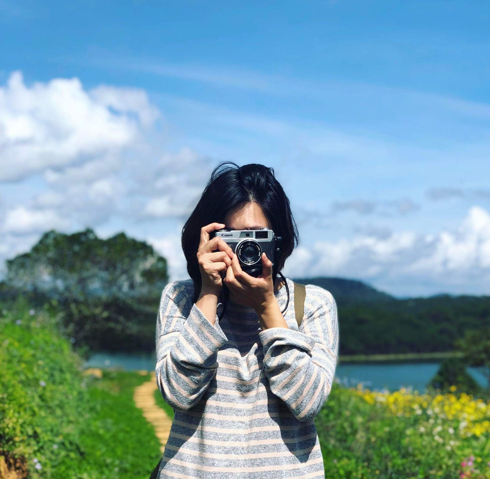
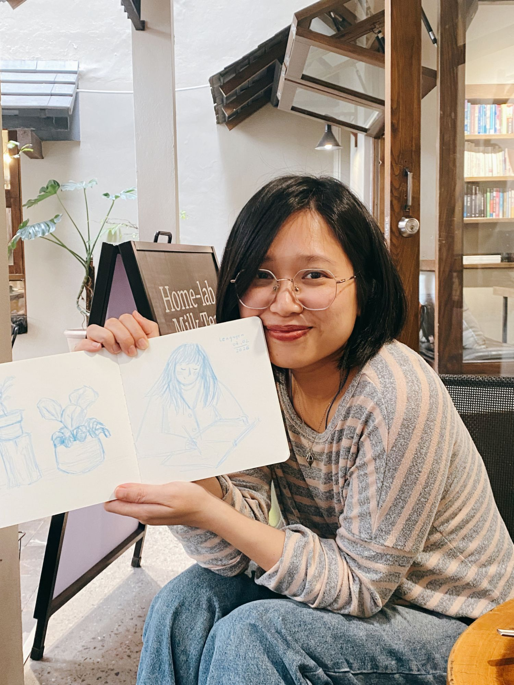

## Chào bạn 👋

Mình là Minh Fam, một người vừa mới chạm ngõ 4x.

Để hình dung nhanh về mình thì mình là sự kết hợp giữa một Bạch Dương điển hình và một INFP chính hiệu. Chắc cũng vì combo tính cách này mà dù ở tuổi nào, mình vẫn giữ nguyên sự tò mò háo hức với thế giới xung quanh, thích mày mò cái mới, nhưng lại không mấy mặn mà với những cuộc đua quá nhiều áp lực hay cạnh tranh ngoài kia.

## Lý do mình bắt đầu làm website này

Mình tạo ra góc nhỏ này để gom góp và sắp xếp lại những mảnh ghép mình tâm đắc: vài ghi chép đúc kết từ sách vở, mấy công cụ nho nhỏ mình tự mày mò làm ra, và cả những sở thích con con giúp mình cân bằng cuộc sống.

Thật ra, đã có một khoảng thời gian mình mang rất nhiều hoài nghi về giá trị bản thân. Trên hành trình tự đối thoại và học cách bước qua những tiếng nói đầy phán xét ở bên trong, mình vỡ ra được nhiều điều hay ho. Thế là mình muốn viết xuống, chia sẻ lại trên mạng xã hội vì biết đâu ở ngoài kia, cũng có ai đó đang loay hoay giống mình ngày trước và tình cờ tìm thấy một chút đồng cảm.

Mình chọn theo đuổi triết lý **Learn in Public** (học tập công khai) vì nhận ra rằng: việc mở cửa chia sẻ quá trình tự học không chỉ giúp mình giữ kỷ luật và hiểu sâu vấn đề hơn, mà còn là cách tự nhiên nhất để kết nối với những người cùng tần số. Nếu những ghi chép hay công cụ nhỏ bé ở đây giúp ích được cho hành trình của bạn dù chỉ một chút thôi, thì góc nhỏ này đã làm tròn vai của nó rồi.

## Hành trình cá nhân

Nhìn lại chặng đường đã qua, hành trình của mình chưa bao giờ là một đường thẳng cả, mà nó là chuỗi những lần tò mò thử nghiệm, tự đúc kết rồi chuyển hóa bản thân qua từng giai đoạn.

Trên hành trình dò đường đầy thú vị đó, có hai dự án cá nhân mà mỗi khi nhắc tới, mình vẫn luôn thấy tự hào và biết ơn:

- **Giầy hoa nhà Minh:** Nơi mình tự tay thiết kế từng mẫu giày vải hoa thủ công, lo từ khâu sản xuất đến chụp ảnh và gói ghém từng đơn hàng gửi đi. Thực sự đó chỉ là một trải nghiệm kinh doanh nhỏ nhưng dạy mình rất nhiều về sự tỉ mỉ và thấu hiểu khách hàng.
- **Herbloom Studio:** Góc nhỏ chuyên về thiết kế landing page và xây dựng bộ nhận diện thương hiệu cho các solopreneurs và coaches - nơi mình biến những ý tưởng của khách hàng thành một sự xuất hiện đồng bộ trong các điểm chạm với khách hàng.

Hiện tại, song song với công việc full-time, mình đang ấp ủ và từng bước học tập để tìm một **công việc remote**. Mình chọn hướng đi này không chỉ để phát huy thế mạnh về tổ chức, vận hành và thiết kế, mà còn vì mình có một dự định là có thể làm việc hoàn toàn từ xa để sớm hiện thực hóa kế hoạch chuyển về quê sinh sống, tận hưởng một nhịp sống chậm rãi và bình yên hơn.

## Khi không làm việc thì mình làm gì

Mình có một tình yêu đặc biệt dành cho những thứ mang tính thị giác (visual) như nhiếp ảnh, sketch và vẽ minh họa. Với mình, việc giơ máy bắt trọn một khoảnh khắc đời thường hay hí hoáy ký họa vài nét nguệch ngoạc không chỉ là thú vui lúc rảnh rỗi, mà còn là cách để mình sống chậm lại, quan sát thế giới một cách chậm rãi hơn và giữ cho tâm trí được thả lỏng.

## Bạn là người mới ghé thăm? Hãy bắt đầu từ đâu?

Nếu đây là lần đầu tiên bạn đến với blog của mình, đây là lộ trình đọc mình xin phép được gợi ý:

1. Đọc bài viết về Tư duy cốt lõi: [Chèn link bài viết tiêu biểu 1]
2. Đọc bài viết về Phương pháp thực hành: [Chèn link bài viết tiêu biểu 2]
3. Thử nghiệm Công cụ / Template miễn phí: [Chèn link tài nguyên 1]

## Kết nối & Liên hệ (Connect & Contact)

Mình luôn mong muốn được kết nối, học hỏi và trao đổi cùng những tâm hồn đồng điệu. Bạn có thể tìm thấy mình tại:

- **Substack / Blog:** https://minhfam.substack.com/
- **Facebook:** https://web.facebook.com/profile.php?id=61596318492128
- **Email cá nhân:** hongminh.fam@gmail.com

Cảm ơn bạn đã dành thời gian đọc trang giới thiệu này.
Mình chúc bạn luôn tìm thấy cảm hứng và giá trị hữu ích trong hành trình phát triển của riêng mình!
